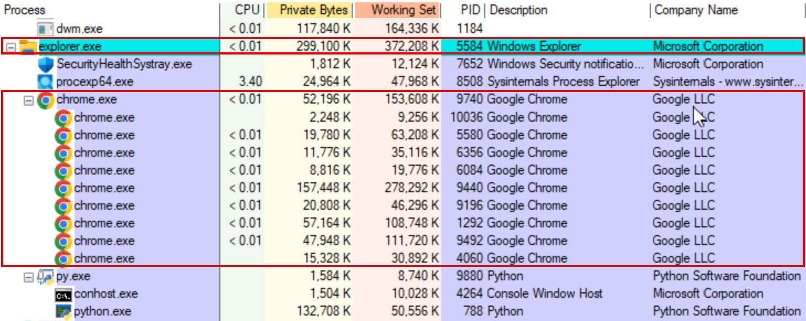
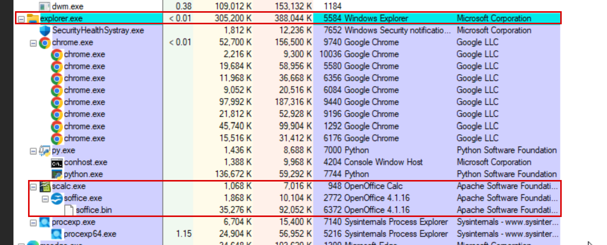

# Synthetic Human Agent

> A synthetic office worker for a Sysmon-monitored Windows VM.
> Built for the **NTU x ST Engineering Hackathon**: *Building a Synthetic Human Agent*.

For 15 minutes the agent uses a Windows desktop the way a real employee would: it browses websites, reads and scrolls, clicks real links, drafts an email in OpenOffice Writer and fills in a spreadsheet in OpenOffice Calc. Every keystroke, mouse movement and pause is randomised within human-like bounds, so the **process tree and Sysmon telemetry it leaves behind look like a person at work, not a script**.

The purpose is defensive: generating realistic, *benign* user activity so that security monitoring and cyber-range exercises have believable background noise to work with.

<!-- Replace with the YouTube / Vimeo link once uploaded -->
**Demo video:** _coming soon_

---

## What it does

The main loop runs for exactly 15 minutes and mixes three kinds of work:

### Web browsing
1. Opens **Chrome** from the Windows Start menu (Win key → type "chrome" → Enter).
2. Moves the cursor to the middle of the screen along a curved path.
3. Focuses the address bar (Ctrl+L) and **types** one of 10 designated URLs (Apple, Coursera, AP News, AWS, Dell, Samsung, Amazon, Coinbase, CoinGecko, CoinMarketCap).
4. Checks the window title to make sure the page actually loaded, and goes back if it shows an error.
5. Reads the page in **irregular scroll bursts** (1-3 wheel scrolls at a time, 8-14 in total) with pauses in between.
6. After a burst, it sometimes looks for a **real hyperlink** on the page and clicks it with a human-like mouse movement, then reads the new page, sometimes goes back (Alt+Left), and sometimes stops browsing early.
7. Closes the tab with Ctrl+W.

### OpenOffice Writer: drafting an email
Opens Writer from the Start menu, types a short weekly-report email line by line (recipient, subject, greeting, body, sign-off), saves it as `Email_Draft_<n>.odt` and quits with Ctrl+Q.

### OpenOffice Calc: filling a spreadsheet
Opens Calc from the Start menu, enters a small quarterly sales table cell by cell using Tab and Enter, saves it as `Data_<n>.ods` and quits with Ctrl+Q.

### Scheduling
- Writer and Calc are **mandatory**: each runs once per session, in random order, on every third task or as soon as less than 4 minutes remain.
- All other slots are browsing tasks, drawing from a shuffled pool of the 10 sites.
- A short random rest follows every task.
- When 15 minutes are up, a final clean-up closes any windows that are still open.

---

## How it maps to the judging criteria

| Criterion | Weight | How the agent addresses it |
|---|---|---|
| **Process Authenticity** | 30% | Every app is opened through the Windows Start menu, exactly as a person would, so the new process is started by the Windows shell rather than by `python.exe`. |
| **Human Entropy & Timing** | 30% | Variable typing speed with typos corrected by Backspace, short and long thinking pauses, curved mouse paths with overshoot, uneven scrolling, occasional long breaks. Nothing runs on a fixed interval. |
| **Action Complexity** | 20% | End-to-end tasks with real results: a document and a spreadsheet saved to disk, real links found and followed, page loads checked. |
| **Resource Efficiency** | 20% | One lightweight Python process that spends most of its time sleeping between actions; no busy loops or continuous screen capture. |

---

## How it works

```
                 ┌───────────────────────────────┐
                 │  agent_15min.py               │
                 │  Brain: 15-minute scheduler   │
                 └───────────────┬───────────────┘
        ┌────────────────────────┼────────────────────────┐
        ▼                        ▼                        ▼
 recognition.py             cursor.py                Typing_2.py
 Eyes: find real links      Hands: move & click      Mouth: type like a human
```

### 🖱 Hands: `cursor.py`
- Moves along a **cubic Bézier curve** that bows to one side, like a hand sweeping across a desk.
- **Slow-fast-slow** speed profile (smootherstep easing), with total time growing with distance (Fitts's-law style).
- About **20% of moves overshoot** the target slightly and then correct.
- Tiny sub-pixel tremor along the path and 1-3 small aim corrections at the end.
- Clicks land a few pixels off the exact centre, with a short pause before and after each click.

### ⌨ Mouth: `Typing_2.py`
- Random delay of **0.06-0.25 s between keystrokes**.
- **5% chance per letter of a typo**: a wrong key is pressed, noticed, deleted with Backspace and corrected.
- **8% chance of a short "thinking" pause** (0.8-2 s) and a smaller chance of a **long pause** (2-5 s).

### 👁 Eyes: `recognition.py`
- **Primary:** walks Chrome's **UI Automation accessibility tree** to find real hyperlinks with their true on-screen positions, keeps only those inside the page content area, and prefers links with descriptive text.
- **Also available:** template matching against a saved screenshot (OpenCV) and OCR text search (Tesseract).
- If no link is found, the agent keeps scrolling and reading rather than clicking straight away.

---

## Repository structure

```
Synthetic-Human-Agent/
├── agent_15min.py     # Main controller: scheduler + web / Writer / Calc tasks
├── cursor.py          # Human-like mouse movement and clicking
├── recognition.py     # Finding real links / buttons on screen
├── Typing_2.py        # Human-like typing with typos and pauses
├── requirements.txt
├── docs/              # Screenshots (process tree, Sysmon events)
├── LICENSE
└── README.md
```

All four `.py` files must stay in the same folder: the main script imports the others by name.

---

## Running it

### Requirements
- Windows 10 / 11
- Python 3
- Google Chrome
- Apache OpenOffice (Writer and Calc)

```bat
py -m pip install -r requirements.txt
```

`uiautomation` is needed for link recognition. `opencv-python` and `pytesseract` are optional extras for the template-matching and OCR strategies.

### Start
```bat
py agent_15min.py
```

Before and during the run:
1. **Switch the keyboard to an English input method**, otherwise typed text will be garbled.
2. After starting, you have **5 seconds to click on the desktop** so the agent has focus.
3. **Do not touch the mouse or keyboard** for the next 15 minutes.
4. **Emergency stop:** move the mouse quickly into the top-left corner of the screen (pyautogui fail-safe).

---

## Verifying the results

| Tool | What to check |
|---|---|
| **Process Explorer** | `chrome.exe` and `soffice.bin` appear in the process tree as user-launched apps, not as children of `python.exe`. CPU and memory of the Python process stay low. |
| **Event Viewer → Sysmon → Operational** | Filter **Event ID 1** (process creation) and check `Image`, `ParentImage` and `CommandLine` for each app the agent opened. |
| **Documents folder** | `Email_Draft_<n>.odt` and `Data_<n>.ods` exist and contain the typed content. |

### Screenshots from a run on the competition VM

**Chrome launched by the agent sits directly under `explorer.exe`**, the same as when a user opens it from the Start menu:



**OpenOffice Calc** (`scalc.exe → soffice.exe → soffice.bin`) is also a child of `explorer.exe`, not of the agent's `python.exe`:



The agent itself is the separate `py.exe → python.exe` branch; none of the apps it opens appear underneath it. CPU use of `python.exe` stays near zero between actions.

---

## Known limitations

- The 10 designated sites need network access. On an offline machine the pages will not load; the agent recognises the error page by its title.
- Link recognition relies on the `uiautomation` package. If it is not installed, the agent cannot see links and falls back to clicking inside the page area.
- Start-menu search and the save dialog assume an English Windows / OpenOffice UI and a default screen layout.

---

## License

[MIT](LICENSE)
